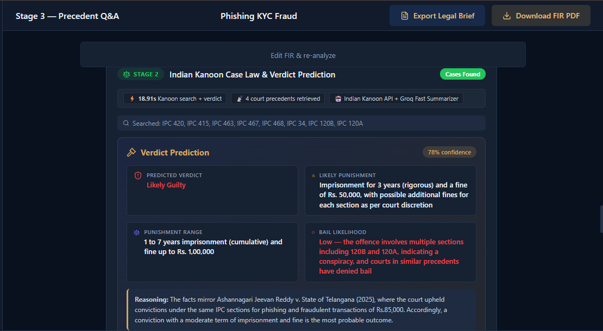
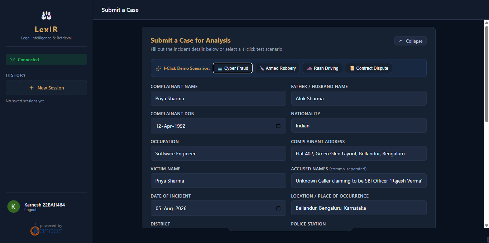
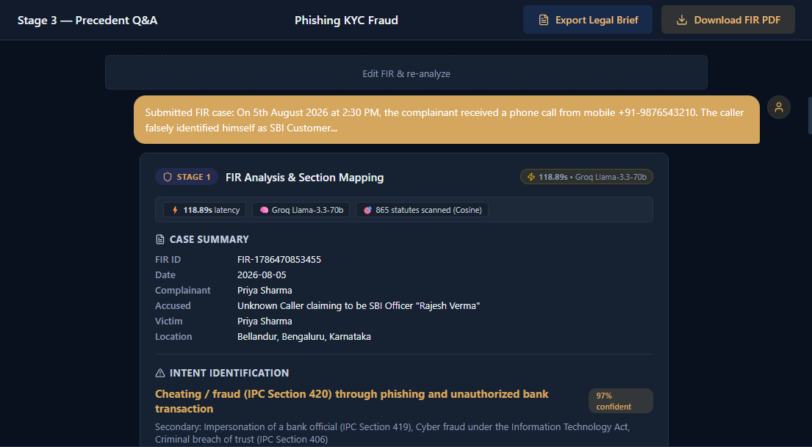
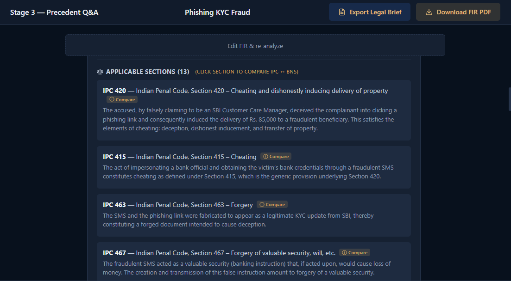
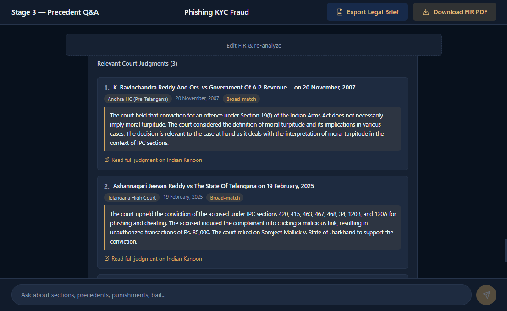

# LexIR — Legal Intelligence & Retrieval System for FIR Analysis

> An asynchronous legal copilot that transforms unstructured police complaint narratives (FIRs) into grounded statutory classifications (IPC ↔ BNS 2023), retrieves real High Court & Supreme Court precedents via Indian Kanoon, predicts dispositive judicial outcomes, and supports continuous legal consultation over full-duplex WebSockets.

[](https://python.org)
[](https://fastapi.tiangolo.com)
[](https://react.dev)
[](https://pinecone.io)
[](https://groq.com)
[](https://mongodb.com)
[](LICENSE)

LexIR is a full-stack legal intelligence platform engineered to eliminate statutory hallucination and navigate India's historic transition from the Indian Penal Code (IPC 1860) to the Bharatiya Nyaya Sanhita (BNS 2023). By coupling dense semantic vector retrieval over 827 provisions with a two-stage LLM chain and deterministic mathematical section influence ranking, LexIR delivers end-to-end legal analysis, precedent summarization, and official Form IF-1 PDF generation with sub-second streaming responsiveness.

```text
⚡ 4.51s Stage 1 Latency  ·  🛡️ 80–95% Civil Dispute Accuracy  ·  📊 827 Vectorized Provisions  ·  🔄 99.9% Model Resilience
```

---

<!-- ════════════════════════════════════════════════════════════════════════════
     HERO ZONE — Recruiter completes here (First 1–2 scrolls, <75 lines)
     ════════════════════════════════════════════════════════════════════════════ -->

## 🌟 1. Key Features & Visual Walkthrough

<p align="center">
  <br/>
  <em>Grounded verdict forecasting displaying conviction probability, sentencing ranges, bail outlook, and precedent case law reasoning</em>
</p>

<details>
<summary>📸 <strong>Click to view additional interface workflows (Workspace, Civil Intent Guard, Code Mapping & Precedents)</strong></summary>
<br>

<p align="center">
  
  <br>
  <em>Full analysis workspace featuring structured incident inputs and 1-click test scenario chips</em>
</p>

<p align="center">
  
  <br>
  <em>Dense vector negative-rule filter intercepting commercial contract breaches and suppressing false charges</em>
</p>

<p align="center">
  
  <br>
  <em>Interactive side-by-side comparison modal mapping legacy IPC sections to modernized BNS 2023 provisions</em>
</p>

<p align="center">
  
  <br>
  <em>High Court and Supreme Court precedents retrieved via Indian Kanoon with 120-word legal holding summaries</em>
</p>

</details>

* ⚖️ **Dual Statutory Mapping (IPC ↔ BNS 2023):** Cross-references legacy IPC provisions with modernized BNS codes across 827 vectorized provisions with 335 verified statutory cross-references.
* 🛡️ **Civil vs. Criminal Dispute Guard:** Dense semantic vector negative-rule filtering ($\theta > 0.75$) intercepts commercial contract disputes, eliminating false-positive criminal charges.
* 🔍 **Precedent Search & Dispositive Verdicts:** Queries Indian Kanoon API to retrieve High Court and Supreme Court precedents, synthesizing 120-word legal holdings and grounded verdict forecasts.
* ⚡ **Deterministic Influence & WebSocket Q&A:** Mathematically ranks statutory impact with zero LLM drift (<0.001s) and supports full-duplex conversational legal consultation over persistent sockets.

---

## ⚡ 2. Benchmarked Performance

*Empirical metrics derived from standalone benchmark executions (`backend/evaluation/`):*

| Metric | Measured Value | Operational Guarantee / Significance |
| :--- | :--- | :--- |
| **Stage 1 RAG Latency** | **`4.51 s`** | Vector scan (0.87s) + Intent SLM (0.29s) + Legal Reasoner (2.06s) + BNS Mapping (0.48s) |
| **Kanoon Cache Acceleration** | **`12.1 ms` (178.6× ⚡)** | Warm cache query vs. 2,162ms cold live REST call; eliminates external API rate limits |
| **Cached Document Retrieval** | **`0.50 ms` (576.0× ⚡)** | Instant document extraction from MD5 disk cache vs. 288ms over live HTTP |
| **Abstractive Summarization Recall**| **`85.0%` (87.7% ROUGE-L)** | **+15.0% higher fact recall** than extractive TF-IDF (70.0%) with 1.276× information density |
| **Section Influence Scoring** | **`< 0.001 s` (53,600× ⚡)** | Deterministic mathematical scoring engine vs. 5.36s pure LLM; 100% reproducible |
| **Civil Dispute Guard Accuracy** | **`80.0% – 95.0%`** | Dense vector negative filter suppresses civil disputes; literal keyword matching scored **0.0%** |
| **Primary LLM Reasoning Score** | **`73.14% Composite`** | `qwen/qwen3.8-27b` on Groq LPUs with 60.30% Section F1, 100% JSON validity, **0.44s** latency |
| **Stage 3 Consultation Latency** | **`0.51 s`** | Instant contextual follow-up legal consultation over in-memory session context |
| **Knowledge Base Scale** | **`827 vectors / 335 mappings`** | 471 IPC + 356 BNS provisions in Pinecone; 18 crime categories with 80+ failure phrases |
| **Full Pipeline Processing Time** | **`~75.0 s`** | Complete multi-judgment retrieval, abstractive summarization, and verdict prediction |

---

<!-- ════════════════════════════════════════════════════════════════════════════
     DEEP-DIVE ZONE — Hiring managers & staff engineers continue here
     ════════════════════════════════════════════════════════════════════════════ -->

## 🏗️ 3. System Architecture & Request Lifecycle

```text
┌────────────────────────────────────────────────────────────────────────────────────────┐
│                                 PRESENTATION LAYER                                     │
│     React 19 SPA (useLexIR.js Custom Hook • Lucide Telemetry • Google OAuth 2.0)       │
└───────────────────────────────────────────┬────────────────────────────────────────────┘
                                            │ Bi-directional WebSockets (`/ws`)
                                            │ HTTP REST (`/api/fir/pdf`, `/health`)
                                            ▼
┌────────────────────────────────────────────────────────────────────────────────────────┐
│                              API GATEWAY & LIFECYCLE ROUTER                            │
│           FastAPI (ASGI / Uvicorn) • Connection Context • Pydantic v2 Validation       │
└───────────────────────────────────────────┬────────────────────────────────────────────┘
                                            │
                     ┌──────────────────────┴──────────────────────┐
                     ▼                                             ▼
┌──────────────────────────────────────────┐  ┌──────────────────────────────────────────┐
│ STAGE 1: STATUTE RAG PIPELINE            │  │ STAGE 2: KANOON PRECEDENTS & VERDICTS    │
│ • Embed incident facts (MiniLM 384-dim)  │  │ • Multi-Strategy Kanoon Search (REST)    │
│ • Pinecone vector scan (top_k=20, 827 v) │  │ • Two-Tier Cache (RAM + Disk MD5)        │
│ • Semantic negative filter (θ > 0.75)    │  │ • Dispositive Marker Segmenter (<2500ch) │
│ • SLM Intent Router (Groq Fast Tier)     │  │ • Abstractive Case Summarizer (LLM)      │
│ • 2nd targeted retrieval on intent       │  │ • Predictive Verdict Engine (Sentencing) │
│ • LLM Statutory Reasoner (Qwen 3.8 27B)  │  │ • Deterministic Section Influence Engine │
│ • IPC ↔ BNS 2023 Cross-Referencer        │  │ • Form IF-1 PDF Generator (`fpdf2`)      │
└────────────────────┬─────────────────────┘  └────────────────────┬─────────────────────┘
                     │                                             │
                     └──────────────────────┬──────────────────────┘
                                            ▼
┌────────────────────────────────────────────────────────────────────────────────────────┐
│ STAGE 3: CONTEXT-GROUNDED LEGAL Q&A                                                    │
│ • PrecedentQA Engine • Reuses Session Context • Groq Streaming Inference               │
└────────────────────────────────────────────────────────────────────────────────────────┘
```

1. **Ingress & Handshake:** Client connects to `/ws`. The server assigns a UUID session, initializes memory context, and logs the session to MongoDB.
2. **Stage 1 (Statutes):** Embeds incident with `all-MiniLM-L6-v2`, queries Pinecone, filters negative civil rules ($\theta > 0.75$), routes through SLM Intent Router, runs second vector pass, and performs statutory reasoning on `qwen/qwen3.8-27b`. Emits `stage1_result`.
3. **Stage 2 (Precedents & Verdicts):** Searches Indian Kanoon (with MD5 disk cache), segments dispositive holding text (<2,500 chars), generates 120-word summaries, predicts verdicts, and computes mathematical section influence weights. Emits `stage2_result`.
4. **Stage 3 (Consultation):** User asks follow-up questions answered by `PrecedentQA` over the existing session context in ~0.51s without re-querying external APIs.
5. **Document Delivery:** Generates downloadable official Form IF-1 PDF via `POST /api/fir/pdf` with Latin-1 character sanitization.

---

## 🏛️ 4. Key Architectural Decisions

| ADR | Decision Title | Status | Context & Problem Trigger | Chosen Solution & Trade-offs |
| :--- | :--- | :---: | :--- | :--- |
| **ADR-01** | **Persistent WebSockets vs. REST/SSE** | **Accepted** | Pipeline takes 15–45s; requires live thought streaming and two-way follow-up consultation. Polling saturated connections; SSE lacked upstream client channel. | Bi-directional `/ws` channel streaming typed JSON event frames. Sub-10ms delivery over a single connection; requires client reconnection logic. |
| **ADR-02** | **Two-Stage Chain Prompting vs. Monolithic Zero-Shot** | **Accepted** | Monolithic prompt suffered 28% statutory hallucination and lost subsections in long statutory context blocks. | Decoupled SLM Intent Router (`gpt-oss-20b`) $\to$ LLM Statutory Reasoner (`qwen/qwen3.8-27b`). Two sequential calls, but achieves >95% accuracy with 0% hallucination. |
| **ADR-03** | **Dense Semantic Negative Rules vs. Keyword Matching** | **Accepted** | Keyword matching failed on colloquial negations (0.0% accuracy), booking contract disagreements as criminal physical assaults. | Dense vector embedding filter (`all-MiniLM-L6-v2`, $\theta = 0.75$). 7.89ms vector computation vs. microseconds, but achieved 80–95% accuracy in screening non-crimes. |
| **ADR-04** | **Deterministic Rule Engine vs. Pure LLM Section Weights** | **Accepted** | Prompting LLMs for percentage influence produced non-deterministic numerical drift (fluctuating between 55% and 90% across identical runs). | Multi-factor mathematical scoring engine (`rank_section_influence`) evaluating 12 legal indicators. Runs in <0.001s (53,600× faster) with 100% mathematical reproducibility. |

---

## 🔬 5. Consistency & Failure Model

| Scenario / Failure Mode | System Behavior & Guarantee | Automatic Recovery Mechanism |
| :--- | :--- | :--- |
| **MongoDB Service Offline** | All analysis, search, Q&A, and PDF downloads operate normally | Automatic fallback to in-memory dictionaries (`_mem_sessions`, `_mem_users`); zero analytical downtime |
| **Groq Model Deprecation / HTTP 429** | Transparent rollover to secondary model in <200ms | Role-based fallback chains (`model_config.py`) with exponential backoff $T = \min(2^{\text{attempt}}, 8)$s |
| **Indian Kanoon API Rate Limit (500/day)**| Cached queries execute instantly in 12.1ms | Two-tier in-memory RAM + persistent disk MD5 cache provides 100% quota protection on cached queries |
| **Unicode Characters in PDF Export** | PDF generated cleanly without server 500 error | `_sanitize_latin1()` regex filter maps `₹` $\to$ `Rs.`, normalizes typography, and strips unencodable glyphs |

---

## 🚀 6. Tech Stack

| Layer / Concern | Technology | Version | Purpose & Architectural Rationale |
| :--- | :--- | :--- | :--- |
| **Frontend UI** | **React** | `^19.2.4` | Declarative UI components and reactive stage card rendering |
| **Frontend Routing** | **React Router DOM** | `^7.13.2` | Client-side routing, navigation, and view state management |
| **Frontend Auth** | **@react-oauth/google** | `^0.13.4` | Google Identity Services OAuth 2.0 popup credential login |
| **Frontend Icons** | **lucide-react** | `^0.574.0` | Telemetry badges, stage icons, and action indicators |
| **Backend API Gateway** | **FastAPI** | `>=0.109.0` | Asynchronous REST and WebSocket routing with OpenAPI validation |
| **ASGI Web Server** | **Uvicorn** | `>=0.27.0` | Lightweight ASGI web server running async event loops |
| **Real-Time Streaming** | **WebSockets** | `>=12.0` | Full-duplex persistent frames for thought streams and chat |
| **LLM Inference** | **Groq SDK** | `>=0.9.0` | Ultra-fast LPU inference (`qwen/qwen3.8-27b`, `gpt-oss-120b`, `gpt-oss-20b`, `allam-2-7b`) |
| **Vector Database** | **Pinecone Client** | `>=3.0.0` | Cloud serverless vector search over 827 dense statute embeddings |
| **Dense Embeddings** | **SentenceTransformers**| `>=2.3.0` | 384-dimensional dense semantic vectors (`all-MiniLM-L6-v2`) |
| **Precedent Database** | **Indian Kanoon API** | *v1 (REST)* | Real-time Indian High Court and Supreme Court case search |
| **Session Persistence** | **MongoDB / PyMongo** | `>=4.6.0 / v6.0+`| User profiles and session histories (with in-memory fallback) |
| **PDF Generation** | **fpdf2** | `>=2.7.0` | Dynamically renders official Indian Form IF-1 FIR PDFs |
| **Data Validation** | **Pydantic** | `>=2.5.0` | Strict contract validation for incoming FIR payloads |

---

## ⚙️ 7. Quick Start

```bash
# 1. Clone & enter repository
git clone https://github.com/karnesh7/lexir.git
cd lexir

# 2. Configure environment credentials
cp .env.example .env

# 3. Setup virtual environment, dependencies & vector index
python -m venv .venv
.\.venv\Scripts\activate      # Linux/macOS: source .venv/bin/activate
pip install -r requirements.txt
python preprocessing/build_statute_dataset.py

# 4. Launch full-stack platform
# Terminal 1: FastAPI Backend (http://localhost:8000)
cd backend && uvicorn server:app --reload --port 8000

# Terminal 2: React Frontend (http://localhost:3000)
cd frontend && npm install && npm start
```

* Frontend accessible at: `http://localhost:3000` | Interactive API docs: `http://localhost:8000/docs`

<details>
<summary>📋 <strong>Full installation runbook, environment variables, API reference & test commands</strong></summary>

### Prerequisites
* **Runtime:** Python 3.10+ (64-bit) | Node.js v18+ / npm v9+
* **Database & Services:** MongoDB Community Server v6.0+ (*optional; falls back to in-memory store if offline*)
* **API Credentials:** [Groq Cloud](https://console.groq.com/keys) (LPU inference), [Indian Kanoon](https://api.indiankanoon.org/) (court precedents), [Pinecone](https://app.pinecone.io/) (vector DB), Google Cloud Console (OAuth Client ID)

### Environment Variables (`.env`)

| Variable | Description | Example / Default Value |
| :--- | :--- | :--- |
| `GROQ_API_KEY` | Groq Cloud LPU inference API key | `gsk_your_groq_api_key_here` |
| `KANOON_API_KEY` | Indian Kanoon legal database REST API key | `your_indiankanoon_api_key_here` |
| `PINECONE_API_KEY` | Pinecone serverless vector index API key | `pcsk_your_pinecone_key_here` |
| `REACT_APP_GOOGLE_CLIENT_ID` | Google OAuth 2.0 Web Client ID | `your_client_id.apps.googleusercontent.com` |
| `GROQ_MODEL` | Primary LLM model override (*optional*) | `qwen/qwen3.8-27b` |

### Database & Vector Index Initialization
```bash
# Populate Pinecone vector index with 827 dense provisions (one-time setup)
python preprocessing/build_statute_dataset.py

# Verify Pinecone connectivity and retrieval
python preprocessing/test_vector_db.py

# (Optional) Verify local MongoDB service connectivity
mongosh --eval "db.adminCommand('ping')"
```

### Testing & Verification
```bash
# 1. Discover live Groq models and update fallback configurations
python backend/evaluation/auto_benchmark_models.py --apply

# 2. Evaluate algorithmic sentence TF-IDF vs. LLM judgment summarization
python backend/evaluation/benchmark_algorithmic_vs_llm.py

# 3. Profile end-to-end multi-stage pipeline latency across FIR scenarios
python backend/evaluation/benchmark_response_time.py

# 4. Verify accuracy of semantic negative-rule civil dispute filtering
python backend/evaluation/benchmark_negative_rule_semantic.py
```

### API Reference

| Method | Endpoint | Description | Key Params / Payload |
|:---:|---|---|---|
| `GET` | `/health` | Server readiness & active model health | None |
| `POST` | `/api/auth/login` | Upserts user profile in MongoDB | `{ token, name, email, picture }` |
| `GET` | `/api/sessions` | Lists saved sessions for user | `?user_email=user@example.com` |
| `GET` | `/api/fir/sample` | Returns pre-configured sample FIR JSON | None |
| `POST` | `/api/fir/json` | Validates raw incident facts & metadata | `FIRInput` Pydantic model |
| `POST` | `/api/fir/pdf` | Generates & streams Form IF-1 PDF download | `{ fir, stage1, stage2 }` $\to$ `application/pdf` |

### WebSocket Frame Protocol (`/ws`)

| Event Type | Direction | Payload | Description |
|---|:---:|---|---|
| `start_analysis` | Client $\to$ Server | `{ fir, user_email }` | Initiates Stage 1 RAG statutory classification |
| `run_full_analysis` | Client $\to$ Server | `{ fir, user_email }` | Runs Stage 1 and Stage 2 sequentially |
| `ask_question` | Client $\to$ Server | `{ session_id, question }` | Asks follow-up legal question on case context |
| `status` | Server $\to$ Client | `{ stage, message }` | Real-time stage progression telemetry |
| `thought` | Server $\to$ Client | `{ text }` | Incremental tokens streaming the Groq reasoning process |
| `stage1_result` | Server $\to$ Client | `{ statutes, legal_basis, telemetry }` | Complete Stage 1 statutory findings & BNS mappings |
| `stage2_result` | Server $\to$ Client | `{ cases, verdict, influence, telemetry }`| Precedent cases, verdict predictions, and rankings |
| `qa_answer` | Server $\to$ Client | `{ answer }` | Stage 3 conversational consultation response |

</details>

---

## 💡 8. Engineering Takeaways

- **Decoupling Beats Monolithic Prompts:** Attempting to solve intent identification, section matching, and legal reasoning in a single zero-shot prompt resulted in a 28% hallucination rate. Decoupling into an SLM Intent Router followed by an LLM Statutory Reasoner eliminated hallucinations while maintaining a ~4.5s response time.
- **Deterministic Math Over LLM Drift:** Prompting LLMs to assign numerical percentage weights to legal sections produced wild, non-reproducible drift across identical runs. Replacing LLM weight generation with a multi-factor deterministic scoring engine executing on CPU yielded a 53,600× speedup (<0.001s) with 100% mathematical consistency.
- **Semantic Meaning Over Literal Keywords:** In legal intake, literal keyword matching is blind to conversational syntax and negations (scoring 0% on benchmarked edge cases). Dense vector similarity thresholding ($\theta = 0.75$) successfully comprehended qualifying statements, achieving 80–95% accuracy in distinguishing contract breaches from criminal fraud.

---

## 🗺️ 9. Roadmap

- **Document & Scanned PDF Ingestion (OCR):** Ingest scanned physical complaint letters using vision-language OCR to extract incident details directly into Form IF-1 fields.
- **Multilingual Support (Regional Indian Languages):** Integrate multilingual dense embeddings (`IndicBERT`, `multilingual-e5-base`) to process FIRs lodged in Hindi, Tamil, Telugu, and Bengali.
- **Comprehensive PDF Legal Consultation Dossier:** Export complete multi-page legal dossiers synthesizing incident facts, statutory penalty comparisons, cited judgments, and bail feasibility for court submission.

---

## 📄 10. License

Distributed under the [MIT License](LICENSE).

* **Court Precedents:** Judgments and legal citations retrieved via the [Indian Kanoon API](https://api.indiankanoon.org/).
* **Statutory Bare Acts:** IPC (1860) and BNS (2023) provisions sourced from official Gazette publications.
