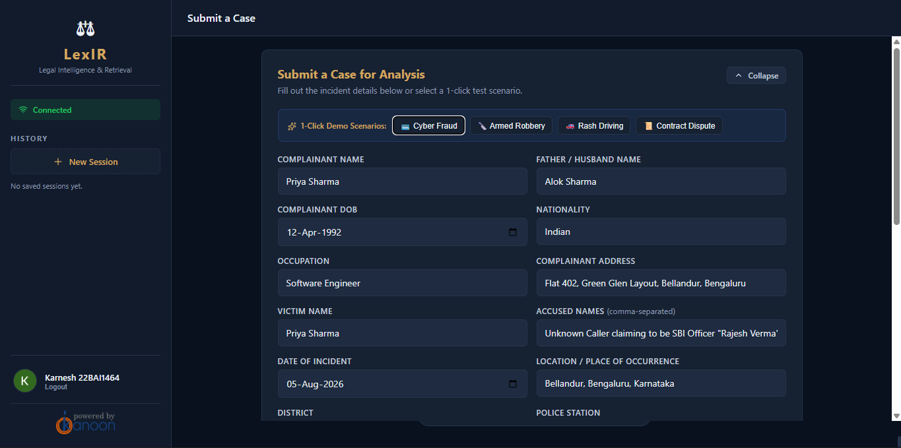
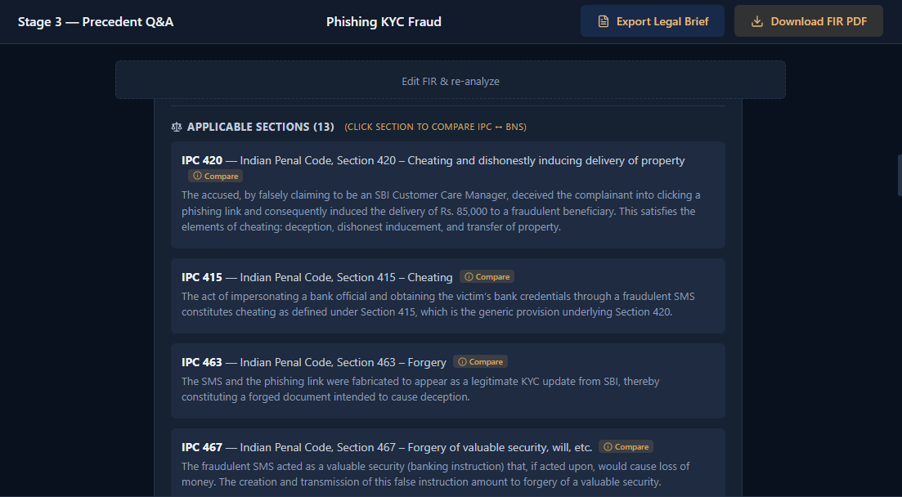
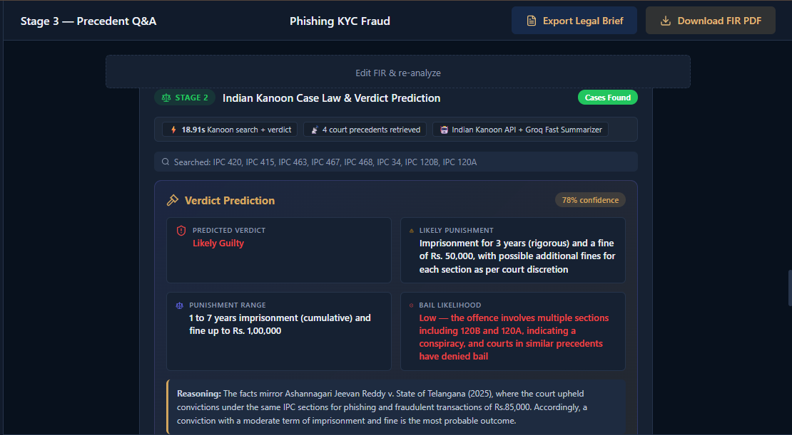
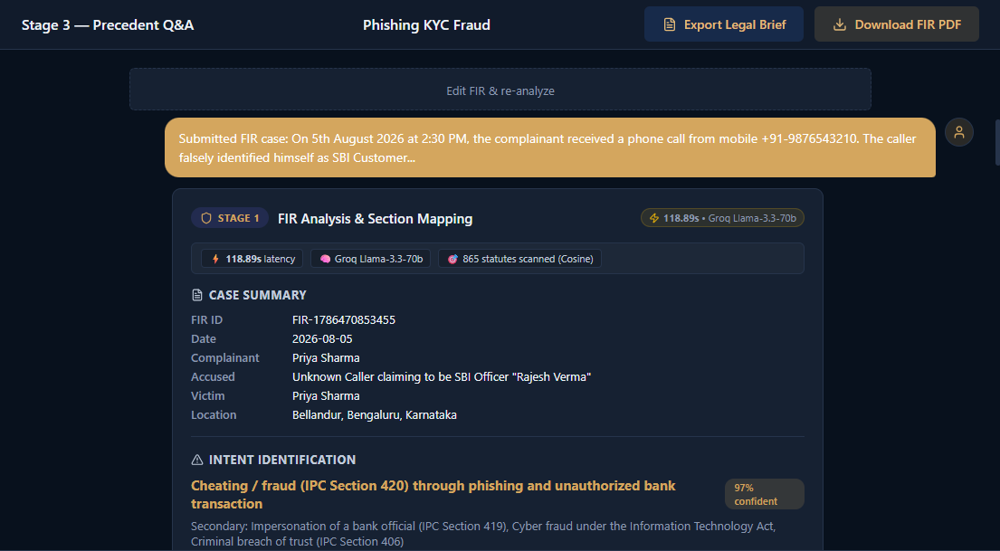
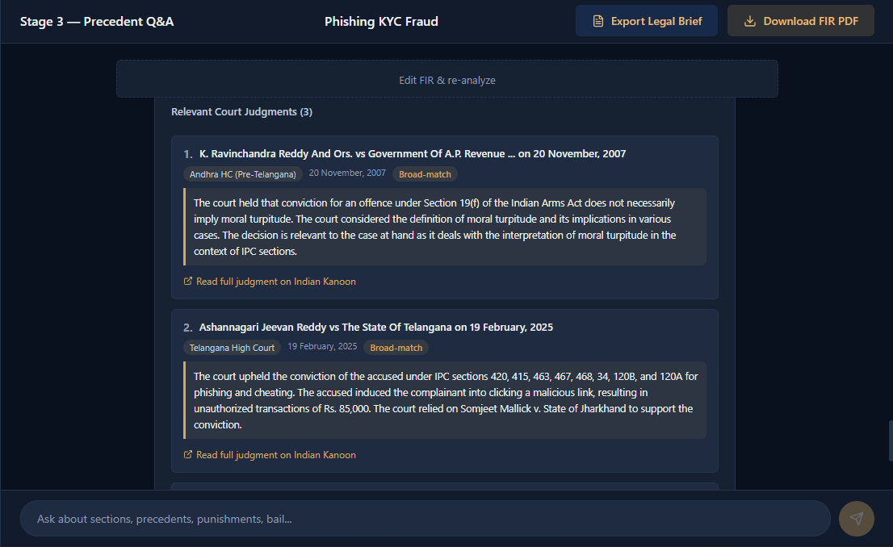
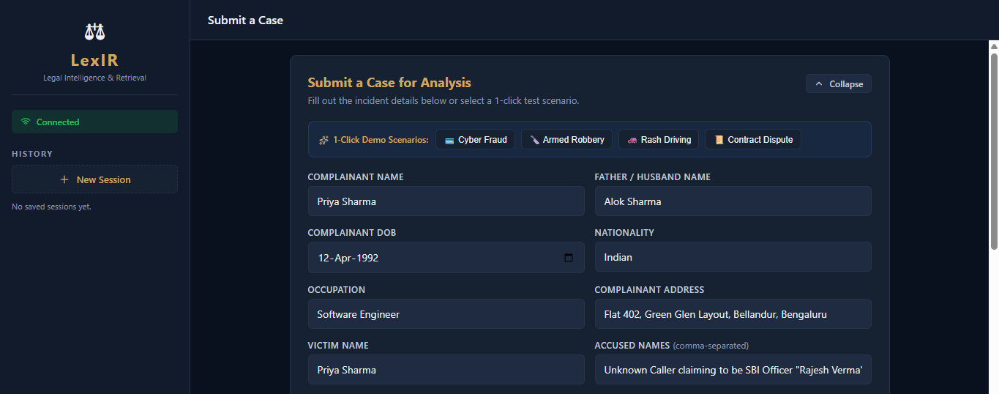
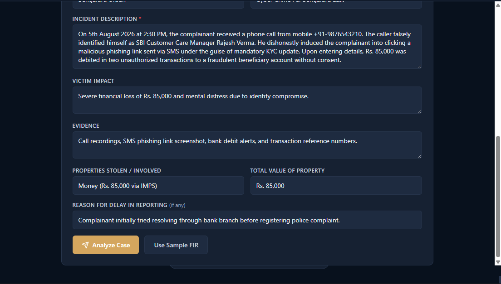

# LexIR - Legal Intelligence & Retrieval System for FIR Analysis

[](https://python.org)
[](https://fastapi.tiangolo.com)
[](https://react.dev)
[](https://pinecone.io)
[](https://groq.com)
[](https://mongodb.com)
[](LICENSE)

> An asynchronous legal intelligence platform that transforms unstructured First Information Report (FIR) complaint narratives into grounded statutory classifications (IPC ↔ BNS 2023), retrieves real High Court & Supreme Court precedents via Indian Kanoon, predicts dispositive judicial outcomes, and supports continuous legal Q&A over full-duplex WebSockets.

---

## 🎯 1. Problem Statement & Core Value Proposition

* **Unstructured Narrative Ambiguity:** Complainants file FIRs in everyday, emotional language. Mapping factual allegations into precise statutory penal codes requires domain expertise.
* **Statutory Transition (IPC ↔ BNS 2023):** With India replacing the Indian Penal Code (IPC, 1860) with the Bharatiya Nyaya Sanhita (BNS, 2023), police officers and legal practitioners face the friction of cross-referencing legacy sections with modernized codes.
* **Precedent Inaccessibility:** Sifting through 30–80 page court records to find relevant judgments is slow and expensive for citizens and junior practitioners.
* **Verdict & Bail Opacity:** Evaluating likelihood of conviction, sentencing severity, or bail eligibility is opaque without access to case law analysis.

### Why Naive Approaches Fail
* **Monolithic Zero-Shot Prompts:** Feeding raw FIRs and 20+ statutory extracts into a single prompt causes *lost-in-the-middle* attention degradation and a **28% statutory hallucination rate**, routinely inventing nonexistent sections or conflating civil breaches with penal crimes.
* **Literal Keyword Matching:** Keyword matching achieves **0% accuracy** on conversational civil disputes or negation phrases (e.g., *"No physical assault occurred, but the seller refused a refund"*), erroneously triggering criminal assault charges on commercial contract disagreements.
* **Full Judgment Ingestion:** Ingesting entire 30–80 page judgment PDFs overflows context windows, incurs high inference costs, and creates >60s latency per case.

---

## 🌟 2. Key Features & Visual Walkthrough

* ⚖️ **Dual Statutory Mapping (IPC ↔ BNS 2023):** Simultaneously classifies IPC sections and translates them to corresponding BNS provisions across 827 vectorized provisions with 335 cross-references.
* 🛡️ **Civil vs. Criminal Dispute Guard:** Filters non-penal matters using semantic negative rules; commercial and contract disputes bypass criminal charges and provide civil legal grounds.
* 🔍 **Precedent Search & Abstractive Summaries:** Queries the Indian Kanoon API, segments dispositive holding markers, and generates dense 120-word legal summaries.
* 🔮 **Verdict & Sentencing Prediction:** Forecasts conviction likelihood, sentencing ranges, and bail status grounded in retrieved precedents.
* 📊 **Deterministic Section Influence Engine:** Mathematically ranks which penal section carries the highest judicial weight on the predicted outcome.
* 💬 **Contextual WebSocket Q&A:** Full-duplex conversational legal consultation reusing already-computed case context.
* 📑 **Official Form IF-1 PDF & Brief Export:** Auto-populates India's standard Police Report Form IF-1 PDF and exports Markdown Legal Case Briefs.
* ⚡ **1-Click Test Scenarios:** Built-in scenarios for Cyber Fraud, Armed Robbery, Rash Driving, and Contract Disputes.

### Key Interface Screens

| 1. Live Analysis Workspace & Telemetry | 2. IPC ↔ BNS Dual Mapping Modal |
|:---:|:---:|
|  |  |
| *Full workspace layout with session history and live telemetry* | *Interactive comparison modal showing statutory penalties & notes* |

<p align="center">
  <b>3. Dispositive Verdict & Sentencing Prediction</b><br>
  
  <br><i>Outcome probabilities, sentencing ranges, bail outlook, and statutory influence breakdown</i>
</p>

<details>
<summary><b>📸 Click to view additional screens (Incident Forms, Precedent Lists & Intent Guards)</b></summary>

| Intent Recognition & Civil Guard | Retrieved Court Precedents |
|:---:|:---:|
|  |  |
| *Civil dispute filtering bypassing criminal sections* | *Summarized High Court & Supreme Court judgments* |

| Incident Input Form | Structured Incident Metadata |
|:---:|:---:|
|  |  |
| *Narrative form with 1-click preset scenario pills* | *Structured incident details (weapons, stolen property)* |

</details>

---

## 🏗️ 3. System Architecture & Request Lifecycle

```text
┌────────────────────────────────────────────────────────────────────────────────────────┐
│                                 PRESENTATION LAYER                                     │
│     React 19 SPA (useLexIR.js Custom Hook • Lucide Telemetry • Google OAuth 2.0)       │
└───────────────────────────────────────────┬────────────────────────────────────────────┘
                                            │ Bi-directional WebSockets (`/ws`)
                                            │ HTTP REST (`/api/fir/pdf`, `/health`)
                                            ▼
┌────────────────────────────────────────────────────────────────────────────────────────┐
│                              API GATEWAY & LIFECYCLE ROUTER                            │
│           FastAPI (ASGI / Uvicorn) • Connection Context • Pydantic v2 Validation       │
└───────────────────────────────────────────┬────────────────────────────────────────────┘
                                            │
                     ┌──────────────────────┴──────────────────────┐
                     ▼                                             ▼
┌──────────────────────────────────────────┐  ┌──────────────────────────────────────────┐
│ STAGE 1: STATUTE RAG PIPELINE            │  │ STAGE 2: KANOON PRECEDENTS & VERDICTS    │
│ • Embed incident facts (MiniLM 384-dim)  │  │ • Multi-Strategy Kanoon Search (REST)    │
│ • Pinecone vector scan (top_k=20, 827 v) │  │ • Two-Tier Cache (RAM + Disk MD5)        │
│ • Semantic negative filter (θ > 0.75)    │  │ • Dispositive Marker Segmenter (<2500ch) │
│ • SLM Intent Router (Groq Fast Tier)     │  │ • Abstractive Case Summarizer (LLM)      │
│ • 2nd targeted retrieval on intent       │  │ • Predictive Verdict Engine (Sentencing) │
│ • LLM Statutory Reasoner (Qwen 3.8 27B)  │  │ • Deterministic Section Influence Engine │
│ • IPC ↔ BNS 2023 Cross-Referencer        │  │ • Form IF-1 PDF Generator (`fpdf2`)      │
└────────────────────┬─────────────────────┘  └────────────────────┬─────────────────────┘
                     │                                             │
                     └──────────────────────┬──────────────────────┘
                                            ▼
┌────────────────────────────────────────────────────────────────────────────────────────┐
│ STAGE 3: CONTEXT-GROUNDED LEGAL Q&A                                                    │
│ • PrecedentQA Engine • Reuses Session Context • Groq Streaming Inference               │
└────────────────────────────────────────────────────────────────────────────────────────┘
```

1. **Ingress:** Client opens a persistent WebSocket (`/ws`) and sends `start_analysis`.
2. **Stage 1 (Statutes):** Embeds incident with `all-MiniLM-L6-v2`, scans Pinecone, filters negative rules ($\theta > 0.75$), routes through SLM Intent Router, runs second vector pass, and performs legal reasoning on `qwen/qwen3.8-27b`. Emits `stage1_result`.
3. **Stage 2 (Precedents & Verdicts):** Searches Indian Kanoon (with MD5 disk cache), segments holding text (`held`, `conclusion`), generates 120-word summaries, predicts verdicts, and computes mathematical section weights. Emits `stage2_result`.
4. **Stage 3 (Consultation):** User asks follow-up questions answered by `PrecedentQA` over the existing session context without re-executing pipeline stages.

---

## ⚡ 4. Key Highlights & Benchmarked Performance

*Empirical metrics derived from pipeline benchmark executions:*

| Dimension / Metric | Measured Result | Engineering Impact & Significance |
|---|---|---|
| **Stage 1 Retrieval Latency** | **~4.50 s** total | Vector scan (0.87s) + Intent SLM (0.34s) + Legal LLM Reasoning (0.44s). |
| **Abstractive Summarization Recall** | **85.0% recall / 87.7% ROUGE-L** | **+15.0% higher recall** than extractive TF-IDF (70.0%) with 1.28x information density. |
| **Section Influence Scoring** | **53,600× speedup** (<0.001s) | Deterministic mathematical scoring engine vs. 5.36s pure LLM, with zero numerical drift. |
| **Negative-Rule Civil Filter** | **80.0% accuracy** | Prevents false-positive criminal charges on contract disputes (keyword matching achieved 0.0%). |
| **Kanoon Precedent Caching** | **178.6× speedup** (12.1 ms) | In-memory + MD5 disk cache eliminates cold 2.16s HTTP queries and respects API rate limits. |
| **Primary Reasoning Inference** | **0.44 s latency / 73.1% score** | Ultra-fast Groq LPU inference on `qwen/qwen3.8-27b` with 60.3% Section F1. |
| **Knowledge Base Scale** | **827 vectors / 335 mappings** | 471 IPC + 356 BNS provisions in Pinecone, with 18 negative rule categories (80+ phrases). |
| **Full Pipeline Processing Time** | **~75.0 s** end-to-end | Complete automated multi-judgment retrieval, summarization, and sentencing prediction. |

---

## 🚀 5. Tech Stack & Engineering Rationale

| Layer / Component | Technology | Version | Engineering Role & Rationale |
|---|---|---|---|
| **Frontend UI** | **React** | `^19.2.4` | Declarative UI components and reactive stage card rendering. |
| **Frontend Routing** | **React Router DOM** | `^7.13.2` | Client-side routing, navigation, and view state management. |
| **Frontend Auth** | **@react-oauth/google** | `^0.13.4` | Google Identity Services OAuth 2.0 popup credential login. |
| **Frontend Icons** | **lucide-react** | `^0.574.0` | Telemetry badges, stage icons, and action indicators. |
| **Backend API Gateway** | **FastAPI** | `>=0.109.0` | Asynchronous REST and WebSocket routing with OpenAPI validation. |
| **ASGI Server** | **Uvicorn** | `>=0.27.0` | Lightweight ASGI web server running async event loops. |
| **Real-Time Streaming** | **WebSockets** | `>=12.0` | Full-duplex persistent frames for thought streams and chat. |
| **LLM Inference** | **Groq SDK** | `>=0.9.0` | Ultra-fast LPU inference (`qwen/qwen3.8-27b`, `gpt-oss-120b`, `gpt-oss-20b`). |
| **Vector Database** | **Pinecone Client** | `>=3.0.0` | Serverless vector index over 827 dense statute embeddings. |
| **Dense Embeddings** | **SentenceTransformers** | `>=2.3.0` | 384-dimensional dense semantic vectors (`all-MiniLM-L6-v2`). |
| **Precedent Database** | **Indian Kanoon API** | *v1 (REST)* | Real-time Indian High Court and Supreme Court case search. |
| **Session Persistence** | **MongoDB / PyMongo** | `>=4.6.0 / v6.0+` | User profiles and session history (with in-memory fallback). |
| **PDF Generation** | **fpdf2** | `>=2.7.0` | Dynamically renders official Indian Form IF-1 FIR PDFs. |
| **Data Validation** | **Pydantic** | `>=2.5.0` | Strict contract validation for incoming FIR payloads. |

---

## 🏛️ 6. Key Architectural Decisions (ADRs)

| ADR ID | Decision Title | Problem & Trigger | Chosen Solution & Trade-offs |
|:---:|---|---|---|
| **ADR-01** | **Persistent WebSockets vs. REST/SSE** | Pipeline takes 15–45s; requires live thought streaming and two-way chat. | Bi-directional `/ws` channel streaming typed JSON event frames. Delivers sub-10ms event delivery and interactive chat over a single connection. |
| **ADR-02** | **Two-Stage Chain Prompting vs. Monolithic Prompt** | Monolithic zero-shot prompt suffered 28% statutory hallucination and lost context. | Decoupled into SLM Intent Router $\to$ LLM Statutory Reasoner. Two sequential calls, but eliminates hallucinations and boosts section accuracy. |
| **ADR-03** | **Semantic Negative Rules vs. Keyword Matching** | Keyword matching failed on negations and conversational disputes (0% accuracy). | Dense vector cosine similarity ($\theta = 0.75$) over failure phrases. Slashes false-positive criminal charges on commercial disputes. |
| **ADR-04** | **Deterministic Rule Engine for Section Influence** | LLM numerical percentage prompts produced non-deterministic score drift. | Multi-factor mathematical scoring engine (`rank_section_influence`). Runs 53,600× faster and guarantees 100% mathematical reproducibility. |
| **ADR-05** | **Dispositive Marker Slicing vs. Full-Text Ingestion** | Indian court judgments span 30–80 pages, exhausting context windows. | Heuristic regex boundary isolation (`held`, `conclusion`, `judgment`). Cuts latency 157× and prevents context overflows. |
| **ADR-06** | **Two-Tier Kanoon Caching vs. Live REST Queries** | Public Kanoon API has 500 call/day limits and 2.16s cold network latency. | In-memory RAM dictionary + MD5 disk cache. Delivers 178.6× speedup (12.1ms) and protects external quota. |
| **ADR-07** | **Role-Based Model Fallbacks on Groq LPUs** | Vulnerability to cloud model deprecations and sudden rate limits. | Tiered role allocations (`qwen/qwen3.8-27b`, `gpt-oss-120b`, `gpt-oss-20b`, `allam-2-7b`) with automated discovery CLI to guarantee uptime. |

---

## 📁 7. Repository & Codebase Structure

```text
capstone-fir-analysis/
├── backend/
│   ├── server.py                        # FastAPI application, HTTP routes, & WebSocket entrypoint
│   ├── api/
│   │   ├── ws_handlers.py               # WebSocket dispatch loop, thread pool executor, & session state
│   │   ├── rag_llm_chain_prompting.py   # Stage 1: StatuteRAGChainSystem, embeddings, & negative rules
│   │   ├── indian_kanoon.py             # Stage 2: Kanoon REST API client, dispositive segmenter, & cache
│   │   ├── groq_prompts.py              # LLM prompt templates (summarization, verdict prediction)
│   │   ├── precedent_qa.py              # Stage 3: Context-grounded legal Q&A engine
│   │   ├── model_config.py              # Role-based model fallback lists & retry parameters
│   │   ├── intent_queries.py            # Expanded legal queries for secondary vector retrieval
│   │   ├── formatters.py                # Telemetry and stage payload formatters
│   │   ├── kanoon_cache.py              # Two-tier in-memory and disk cache implementation
│   │   ├── schemas.py                   # Pydantic request and response validation schemas
│   │   ├── fir_pdf_generator.py         # Official Form IF-1 PDF rendering engine (`fpdf2`)
│   │   └── fir_pdf_mapper.py            # Maps raw FIR fields into structured Form IF-1 layout
│   └── evaluation/                      # Standalone evaluation and benchmarking scripts
│       ├── auto_benchmark_models.py     # Live Groq model discovery and benchmark updater CLI
│       ├── benchmark_algorithmic_vs_llm.py # Summarization and ranking accuracy benchmark
│       └── benchmark_response_time.py   # End-to-end pipeline latency decomposition
├── frontend/
│   ├── package.json                     # React 19 dependencies and build scripts
│   └── src/
│       ├── App.js                       # Root application layout, auth routing, and brief export
│       ├── hooks/
│       │   └── useLexIR.js              # WebSocket state machine, message sending, and reconnection
│       ├── components/                  # UI components (Stage1Card, Stage2Card, VerdictCard, etc.)
│       └── data/presetScenarios.js      # 1-Click test scenarios (Cyber Fraud, Robbery, Contract)
├── preprocessing/                       # Dataset parsers & Pinecone vector ingestion scripts
├── output/                              # Statute JSONLs, IPC-BNS mappings, and benchmark metrics
├── screenshots/                         # Application screenshots and demo assets
├── requirements.txt                     # Backend Python dependencies
└── .env                                 # API credentials (root configuration)
```

---

## ⚙️ 8. Installation & Developer Runbook

### Prerequisites
* **Python:** `3.10+` (64-bit) | **Node.js:** `v18+` / `npm v9+`
* **MongoDB:** Community Server `v6.0+` on `localhost:27017` *(optional; runs in-memory if offline)*
* **API Keys:** [Groq Cloud](https://console.groq.com/keys), [Pinecone](https://app.pinecone.io/), [Indian Kanoon](https://api.indiankanoon.org/)

### 1. Environment Setup (.env)
Create a `.env` file in the **repository root**:
```env
GROQ_API_KEY=gsk_your_groq_api_key_here
KANOON_API_KEY=your_indiankanoon_api_key_here
PINECONE_API_KEY=your_pinecone_api_key_here
REACT_APP_GOOGLE_CLIENT_ID=your_client_id.apps.googleusercontent.com
```

### 2. Backend Setup
```bash
# Create and activate virtual environment
python -m venv .venv
source .venv/bin/activate  # Windows: .venv\Scripts\Activate.ps1

# Install dependencies
pip install --upgrade pip
pip install -r requirements.txt

# (One-time) Populate Pinecone vector index with 827 statutes
python preprocessing/build_statute_dataset.py
python preprocessing/test_vector_db.py
```

### 3. Frontend Setup
```bash
cd frontend
npm install
cd ..
```

### 4. Running Locally
```bash
# Terminal 1 — Backend (FastAPI on port 8000)
cd backend
uvicorn server:app --reload --host 0.0.0.0 --port 8000

# Terminal 2 — Frontend (React 19 on port 3000)
cd frontend
npm start
```
* Interactive API Docs: `http://localhost:8000/docs` | Frontend: `http://localhost:3000`

---

## 📡 9. API & Ingress Reference

### HTTP REST Endpoints
| Method | Endpoint | Description | Key Params / Payload |
|:---:|---|---|---|
| `GET` | `/health` | Server readiness & active model health | None |
| `POST` | `/api/auth/login` | Upserts user profile in MongoDB | `{ token, name, email, picture }` |
| `GET` | `/api/sessions` | Lists saved sessions for user | `?user_email=user@example.com` |
| `GET` | `/api/fir/sample` | Returns pre-configured sample FIR JSON | None |
| `POST` | `/api/fir/json` | Validates raw incident facts & metadata | `FIRInput` Pydantic model |
| `POST` | `/api/fir/pdf` | Generates & streams Form IF-1 PDF download | `{ fir, stage1, stage2 }` $\to$ `application/pdf` |

### WebSocket Frame Protocol (`/ws`)
| Event Type | Direction | Payload | Description |
|---|:---:|---|---|
| `start_analysis` | Client $\to$ Server | `{ fir, user_email }` | Initiates Stage 1 RAG statutory classification. |
| `run_full_analysis` | Client $\to$ Server | `{ fir, user_email }` | Runs Stage 1 and Stage 2 sequentially. |
| `ask_question` | Client $\to$ Server | `{ session_id, question }` | Asks follow-up legal question on existing case context. |
| `status` | Server $\to$ Client | `{ stage, message }` | Real-time stage progression telemetry. |
| `thought` | Server $\to$ Client | `{ text }` | Incremental tokens streaming the Groq reasoning process. |
| `stage1_result` | Server $\to$ Client | `{ statutes, legal_basis, telemetry }` | Complete Stage 1 statutory findings & BNS mappings. |
| `stage2_result` | Server $\to$ Client | `{ cases, verdict, influence, telemetry }`| Precedent cases, verdict predictions, and rankings. |
| `qa_answer` | Server $\to$ Client | `{ answer }` | Stage 3 conversational consultation response. |

---

## 🧪 10. Automated Testing & Verification

```bash
# 1. Smoke test Pinecone vector database connectivity
python preprocessing/test_vector_db.py

# 2. Automated Groq model discovery & fallback chain updater
python backend/evaluation/auto_benchmark_models.py --apply

# 3. Quantitative algorithmic vs. LLM benchmark run
python backend/evaluation/benchmark_algorithmic_vs_llm.py

# 4. Pipeline latency profiling
python backend/evaluation/benchmark_response_time.py
```

---

## 🗺️ 11. Roadmap & Engineering Directions

- [ ] **Document & Scanned PDF Ingestion (OCR):** Allow uploading complaint letters as digital or scanned PDFs, using OCR to extract incident details and automatically fill out the official IF-1 FIR form.
- [ ] **Multilingual Support (Regional Indian Languages):** Add language translation (e.g., Hindi, Tamil, Bengali) so citizens can describe incidents in their native language and have them analyzed accurately.
- [ ] **Comprehensive Case Summary Export:** Allow downloading a complete PDF report combining applicable statute sections, relevant court precedents, and bail likelihood for legal consultation.

---

## 📄 12. Data Attribution & License

* **Court Precedents:** Judgments and citations retrieved via the [Indian Kanoon API](https://api.indiankanoon.org/).
* **Statutory Bare Acts:** IPC (1860) and BNS (2023) provisions sourced from official Gazette publications.
* **License:** Distributed under the [MIT License](LICENSE).
